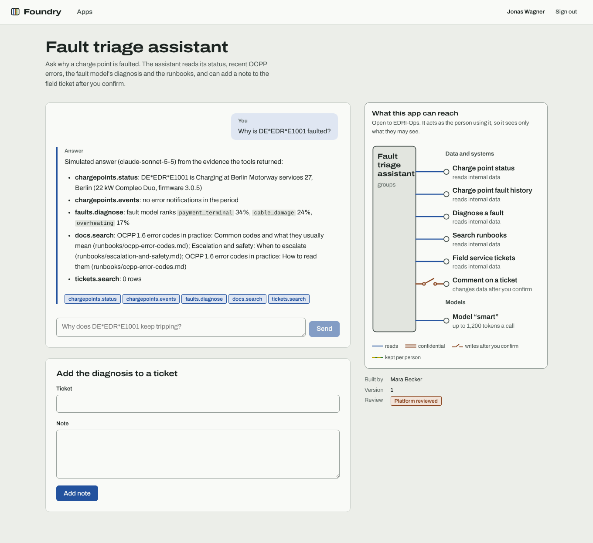

# Foundry: an internal AI app platform for EDRI

Everyone at E.ON Drive Infrastructure should be able to build an AI app, usually with an AI coding
tool, while sign-in, data access, hosting, security, cost and review are the platform's job. Foundry
is that platform, built from scratch and run against a simulated charge-point network.



## What it does

- **Apps are four files.** A manifest declares everything an app may reach (connectors, model
  aliases, storage, audience, daily budget); `handlers.js` runs in a fresh QuickJS sandbox per call
  with CPU, memory and call limits; screens are platform blocks (forms, chats with streaming
  answers, tables, stats, charts); tests run at publish time. See `packages/sdk/BUILDING_APPS.md`.
- **Build by describing.** The console's builder (Claude through a forced tool whose schema is the
  bundle contract, with the gate's findings fed back; a template generator without a key) drafts
  the app, the gate checks it, you try it on real data you may see, and submit it.
- **Build from your editor.** An MCP server lets Claude Code, Copilot or Cursor draft, check,
  preview and submit apps with a personal token that acts as you (scoped, at most 30 days).
- **Review follows reach.** The publish gate (AST analysis of capability use, secrets, UI and
  manifest rules, the app's own tests) assigns a tier: 0 publishes after the checks, 1 needs a
  second builder, 2 (confidential data, writes, external systems, large budgets) needs a platform
  reviewer. Approvals name the bundle's SHA-256; any change is a new version.
- **The person using an app decides what it sees.** Connectors run as the viewer: Entra groups
  decide which connectors answer, PostgreSQL row-level security limits every query to the
  viewer's countries, private app records are per person. Group overage resolves through Graph and
  fails closed when Graph is down.
- **Writes need the person.** Apps cannot call write connectors and models never get them as tools;
  a handler can only ask, and the console shows exactly what will be sent until the person confirms.
- **Cost and load are the platform's.** A model gateway with per-app daily budgets reserved and
  settled atomically in Redis, per-person token limits, rate limits, an answer cache that includes
  the viewer's permission scope, and single-flight for identical concurrent questions. Prometheus
  metrics, per-app usage, a hash-chained append-only audit log.
- **An ML model behind a connector.** A fault model (scikit-learn gradient boosting on 72 hours of
  OCPP events) ranks likely causes of a faulted charge point; apps reach it like any connector.

## Measured

| | |
| --- | --- |
| Fault model, against the simulator's true causes | macro-F1 **0.941** (technicians' rule 0.871), top-2 accuracy 0.984 |
| Fault model, against recorded ticket causes (9.1% of which are wrong) | macro-F1 0.853 (rule 0.787) |
| Sandboxed handler, pure computation, 32 concurrent, 2 vCPU | 304 calls/s, p95 142 ms |
| Handler writing and listing records through RLS | 206 calls/s, p95 206 ms |
| Model call, cache miss (simulated provider: 300 ms + 2 ms/token) | p50 396 ms, 200 provider calls for 200 questions |
| Same questions again (cache hit) | p50 52 ms, p95 86 ms, 0 provider calls |
| 100 identical new questions at once | 1 provider call |
| 200 calls racing for a €0.01 daily budget | spent €0.0023, never more than the budget |
| Tests | 92 TypeScript (contract, sandbox, gate, API, MCP, console), 10 Playwright end-to-end on desktop and phone under the production CSP, 5 pytest |

Numbers come from `reports/fault-model/latest.json` and `reports/load/latest.json`, which the
code writes; CI reruns both. The budget race shows the reservation is conservative: calls reserve
their worst case, so under a burst some are refused that would have fit.

## Held-out sets

`apps/api/heldout/run.test.ts` judges apps by effects, not by the platform's verdicts: canary values
are planted in data nobody in the cases may see, in the environment and on disk; a case "succeeds"
if a canary reaches someone who may not see it, a write happens nobody confirmed or under someone
else's name, spending passes a budget, or another app stops answering. Every set runs twice:
through the gate with a reviewer who approves everything, and with the gate switched off, so the
runtime's enforcement is measured on its own. `heldout/dev-smoke` (written by me, not held out)
checks the runner, including a positive control it must flag.

HELDOUT_RESULTS

## Run it

```bash
docker compose up --build          # then open http://localhost:8081 and sign in as a test person
```

Or without containers: PostgreSQL 16 and Redis 7 running, then `psql -f scripts/bootstrap-db.sql`,
`pnpm install && pnpm -r build`, `pnpm --filter @foundry/api seed && pnpm --filter @foundry/api seed:apps`
(with `DEV_IDP=on SESSION_SECRET=<32+ chars>`), train and start the fault model
(`services/fault-model`: `uv run python -m fault_model.train`, `uv run uvicorn fault_model.service:app --port 8090`),
`node apps/api/dist/main.js`, and `pnpm --filter @foundry/console dev`.

Test people (development identity provider, same token shapes and paths as Entra ID): Mara
(builder, all countries), Jonas (field operations, Germany), Lea (platform reviewer and admin),
Sofia (commercial, Italy, more groups than fit in a token), Tomáš (operations, Central Europe).

## Layout

| | |
| --- | --- |
| `packages/contract` | Bundle, manifest and UI contract (zod), canonical hash |
| `packages/sandbox` | QuickJS runtime with metered CPU across awaits, limits, one host function |
| `packages/gate` | Publish gate: code analysis, secrets, UI and manifest rules, tiers, app tests, runtime enforcement |
| `packages/sdk` | What builders and their coding tools read |
| `apps/api` | Hono API: Entra validation and BFF sign-in, registry and review, runtime, model gateway, connectors, audit, builder |
| `apps/console` | React 19 console: catalog, app runner, builder, reviews, operations, tokens |
| `apps/mcp` | MCP server for AI coding tools |
| `services/fault-model` | FastAPI + scikit-learn fault model and its training |
| `deploy/` | Dockerfiles, nginx, Terraform for Azure (Container Apps, PostgreSQL Flexible Server, Redis, Key Vault, Entra app roles) |
| `config/` | Connectors, models and prices, identity mapping, runbooks |
| `docs/adr/` | Decisions: bundles in a sandbox, viewer-decided access, review by reach, writes need the person |

## Limits, honestly

- The charge-point network, tickets, revenue and contracts are simulated (deterministic, seed 2026).
- Terraform is formatted and validated in CI, not applied to a subscription.
- Entra ID is exercised through a development identity provider with Entra's paths and token
  shapes; the production path (JWKS from login.microsoftonline.com, Graph) is implemented but has
  not signed in a real tenant.
- The Claude path of the builder and gateway is implemented; tests and measurements use the
  simulated provider, so model latency in the load numbers is simulated. Azure OpenAI is not
  implemented.
- Teams posting is simulated into an outbound table.
